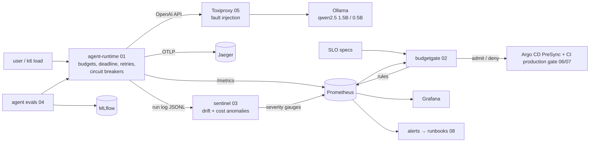

# Deloitte USI: Applied AI SRE lab

Projects built against **Applied AI Site Reliability Engineer III** (Product
Engineering, Hyderabad; [posting](https://usijobs.deloitte.com/en_US/careersUSI/JobDetail/USI-EH27-Product-Engineering-SRE-DevOps-Engineer-III-L45/370064)).
The role is SRE for AI products: run AI and **agentic** workloads to SLOs and
error budgets, gate production on those budgets, test resilience, and catch
AI-specific failures like drift and cost anomalies.

Everything runs on **small local models** (`qwen2.5:1.5b`, `qwen2.5:0.5b` via
Ollama, CPU only). The [Demandbase lab](../demandbase/) next door already covers
the LLM gateway and guardrails; this lab builds on top of that, around an agent.

## JD → project map

| JD | Project | Tools |
|---|---|---|
| *"Operate AI and agentic workloads reliably"*, *"code instrumentation"* | [01-agent-runtime](01-agent-runtime/): bounded tool-using agent (steps/cost/token budgets, run deadline, retries, circuit breakers, loop detection, explicit outcomes) | Python, FastAPI, Prometheus, OpenTelemetry |
| *"SLIs, SLOs, error budgets"*, *"gating production admission on error budgets"* | [02-error-budget-gate](02-error-budget-gate/): SLOs as code → burn-rate rules + release gate CLI | **Go**, Prometheus API |
| *"AI failure modes such as drift and cost anomalies"*, *"AI cost engineering"* | [03-drift-cost-sentinel](03-drift-cost-sentinel/): input/behaviour drift, quality-signal shifts, cost anomalies | Python (PSI, JS divergence, robust z) |
| *"MLflow, LangFuse, LangSmith"*, *"quick, low-cost experiments"* | [04-agent-evals](04-agent-evals/): trajectory evals, pass^k, promotion gate | MLflow, Langfuse |
| *"performance, chaos, and resilience testing"*, *"capacity planning, autoscaling"* | [05-resilience](05-resilience/): k6 with SLO thresholds, Toxiproxy chaos with hypotheses, capacity model | **k6**, Toxiproxy, **Azure Chaos Studio**, **AWS FIS** |
| *"Azure, Azure OpenAI, Kubernetes, Terraform, ArgoCD"*, *"drift prevention"*, *"access controls"* | [06-platform-azure](06-platform-azure/): AKS + managed Prometheus + optional Azure OpenAI, Helm chart, Argo CD with SoD | Terraform azurerm, Helm, Argo CD |
| *"automation across the SSDLC"*, *"DevSecOps, GitHub, SonarQube"*, *"segregation-of-duties controls"* | [07-devsecops](07-devsecops/) + [`.github/workflows/deloitte.yml`](../.github/workflows/deloitte.yml) | GitHub Actions, SonarQube, Trivy, gitleaks, SBOM |
| *"runbooks, technical specs, blameless postmortems"*, *"incident trends and toil"*, *"co-define SLOs and readiness"* | [08-sre-operations](08-sre-operations/): SLO catalogue, error-budget policy, PRR checklist, incident command, toil inventory, runbooks | |
| *"observability, alerting"* | [observability/](observability/): agent alerts + generated SLO alerts with promtool tests, Grafana dashboard | Prometheus, Grafana, Jaeger |

## How the pieces connect



## Quickstart

```bash
cd deloitte
make install && make test      # 50 Python tests + 10 Go tests, no model needed
make sentinel-demo             # drift/cost detectors on 5 synthetic scenarios

make up                        # agent, Ollama (small models), Toxiproxy, Prometheus, Grafana, Jaeger, MLflow
make ask Q="Is payments-api degraded, and can we still ship a feature to it?"
make evals && make eval-compare   # real-model evals → MLflow (localhost:5000) → promotion gate
make load RPS=1 && make capacity TARGET_RPS=5
make chaos                     # latency / outage / stall / flaky-reset experiments
make gate                      # error-budget decision for agent-runtime
```

| UI | URL |
|---|---|
| Agent API | http://localhost:8000/docs |
| Grafana ("Agent Runtime - SLOs, behaviour, cost") | http://localhost:3000 |
| Prometheus alerts | http://localhost:9090/alerts |
| Jaeger | http://localhost:16686 |
| MLflow | http://localhost:5000 |

## What has been verified

| Check | Result |
|---|---|
| Python tests: agent runtime (incl. HTTP service, real-client error classification), sentinel, evals (incl. MLflow tracker), resilience, repo consistency | 50 passed |
| Go: `go vet`, `gofmt`, `go test` (gate policy, rules, fake Prometheus server) | 10 passed |
| Generated SLO rules + agent alerts: `promtool check` and `promtool test` (5 scenarios, incl. "budget stops ticket but don't burn the SLO") | pass |
| Helm: `helm lint` + kubeconform; Argo CD manifests against the Argo CD CRD schemas | valid |
| Terraform (azurerm 4.x): `validate`, `fmt -check` | valid |
| k6: `k6 inspect` for each scenario selection | parses |
| gitleaks over the repo | no leaks |
| ruff | clean |

Not run here: the Docker stack, and therefore the k6 load and the chaos
experiments against real models (no Docker daemon in the build environment),
`terraform plan` (no Azure subscription), and Trivy locally (its download wasn't
reachable). CI covers Trivy, and the `agent-evals` job runs the real models.
