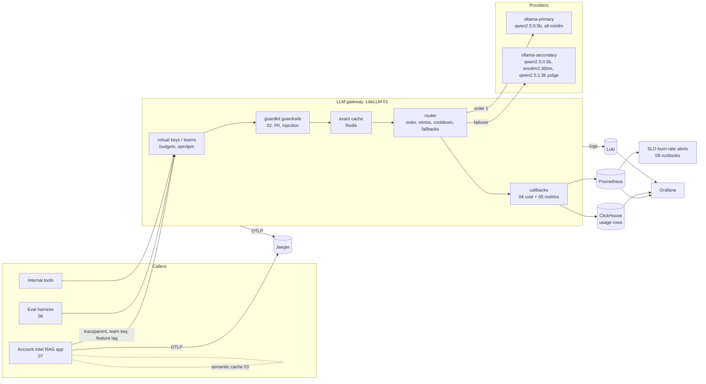

# Demandbase: AI Runtime Services lab

Projects built against the **DevOps Engineer – AI Runtime Services** job description
([posting](https://jobs.ashbyhq.com/demandbase/0cdcc3bc-843f-41d8-a6cc-fcc97f96c5ad)).
The team owns the shared runtime every AI feature runs on: *"the LLM gateway,
cost controls, observability, evals infra, caching, and guardrails"*, and runs
it with real SRE ownership.

This folder builds a small but complete version of that runtime, on the JD's
stack, with **small local models** so it runs on a laptop.

## JD → project map

| JD: "What you'll own" / "What we need" | Project | Stack used |
|---|---|---|
| **The LLM gateway**: keys, routing, rate limits, failover, provider quotas | [01-llm-gateway](01-llm-gateway/) | LiteLLM proxy, Postgres, Redis |
| **Caching and guardrails**: input/output safety, PII handling, policy enforcement at the gateway | [02-guardrails](02-guardrails/) | LiteLLM `CustomGuardrail`, Python |
| **Caching**: response and semantic caching to cut latency and redundant spend | [03-semantic-cache](03-semantic-cache/) | Redis (exact), embeddings (semantic) |
| **Cost control**: per-team and per-model attribution, budgets, quotas; *FinOps instincts* | [04-cost-control](04-cost-control/) | LiteLLM callbacks, ClickHouse, DuckDB |
| **LLM observability**: traces, spans, prompt/response capture, *chased cardinality*, *alerts that fire when they should* | [05-llm-observability](05-llm-observability/) | Prometheus, Grafana, Loki, OpenTelemetry/Jaeger, ClickHouse (Datadog LLM Obs hook included) |
| **Evals and experimentation infra**: harnesses, datasets, scoring; *LLM-as-judge in a real workflow* | [06-evals-harness](06-evals-harness/) | Python, LLM-as-judge, GitLab CI gate |
| *"You need to have built something with these tools: an agent, a RAG pipeline..."* | [07-account-rag-app](07-account-rag-app/) | RAG on the gateway, FastAPI |
| **Kubernetes, AWS, Terraform, GitOps**; EKS, Flux, Karpenter | [08-platform-infra](08-platform-infra/) | Terraform, EKS, Karpenter, Flux, External Secrets |
| **Reliability, for real**: SLOs, on-call, incident response, postmortems | [09-sre](09-sre/) | Burn-rate alerts, runbooks, game days, load tests |
| GitLab CI | [.gitlab-ci.yml](.gitlab-ci.yml) | lint → test → validate → e2e → eval gate → build → GitOps bump |

## Architecture



## Models (all small, all CPU)

| Gateway model group | Backing model | Size | Used for |
|---|---|---|---|
| `chat-small` | `qwen2.5:0.5b` (two deployments, one per "provider") | ~400 MB | default chat |
| `chat-tiny` | `smollm2:360m` | ~230 MB | degraded-mode fallback, cost experiments |
| `judge` | `qwen2.5:1.5b` | ~1 GB | LLM-as-judge in evals |
| `embed-small` | `all-minilm` | ~46 MB | RAG retrieval, semantic cache |

Callers only ever see the group names, so moving `chat-small` to a hosted
model is a config change with no code change for callers.

## Quickstart

```bash
cd llmops-projects/demandbase

# No models needed
make install          # Python deps
make test             # 48 unit tests across all projects
make e2e              # real LiteLLM proxy + real config + plugins against mock providers
make showback DEMO=1  # cost showback + budget alerts on synthetic traffic
make cache-bench      # semantic-cache threshold sweep

# Full stack (Docker, ~2 GB of models)
make up               # gateway, 2x ollama, postgres, redis, clickhouse, prometheus, grafana, loki, jaeger, app
make bootstrap        # teams + virtual keys with budgets (01-llm-gateway/teams.yaml)
make smoke            # end-to-end checks against the live gateway
make evals            # baseline vs candidates on the real models, judge included
make eval-compare     # regression gate (exit 1 on regression)
make gameday SCENARIO=primary-outage
make load RPS=3 DURATION=60
```

| UI | URL |
|---|---|
| Gateway (OpenAI-compatible) | http://localhost:4000 (`/ui` for the LiteLLM admin UI) |
| Account Intel app | http://localhost:8080/docs |
| Grafana (dashboard "AI Runtime - LLM Gateway") | http://localhost:3000 |
| Prometheus alerts | http://localhost:9090/alerts |
| Jaeger traces | http://localhost:16686 |

## What has been verified

| Check | How | Result |
|---|---|---|
| Unit tests (guardrails, cache, cost, metrics/tracing, evals, RAG) | `make test` | 48 passed |
| Gateway e2e: real LiteLLM proxy with this `config.yaml` and plugins, mock Ollama providers | `make e2e` | all 12 checks pass: routing, embeddings, injection block, PII redaction before the provider, exact cache, failover to secondary, clean 5xx on total outage, Prometheus series, served-by backend, guardrail block metric, ClickHouse-schema rows (DuckDB) |
| Alert rules | `promtool check rules` + `promtool test rules` (4 scenarios) | pass. The tests caught a real bug: a routing label `team` was overwriting the metric's `team` label |
| Kubernetes manifests | `kustomize build` + `kubeconform` | valid (CRDs skipped) |
| Terraform | `terraform init -backend=false && terraform validate`, `fmt -check` | valid against the pinned module versions |
| Lint | `ruff check .` | clean |

Not run here: the Docker stack with real Ollama models (no Docker daemon in
the environment this was built in), and `terraform plan/apply` (no AWS account).
The eval numbers in `06-evals-harness` come from running it yourself.
